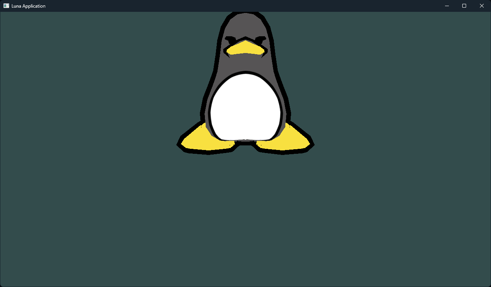

Toying around with rendering and platform-specific programming.

The architecture is designed such that the platform code is separate from the code running on screen. No matter what state the engine is in, platform work can be done and tested against current visuals.
