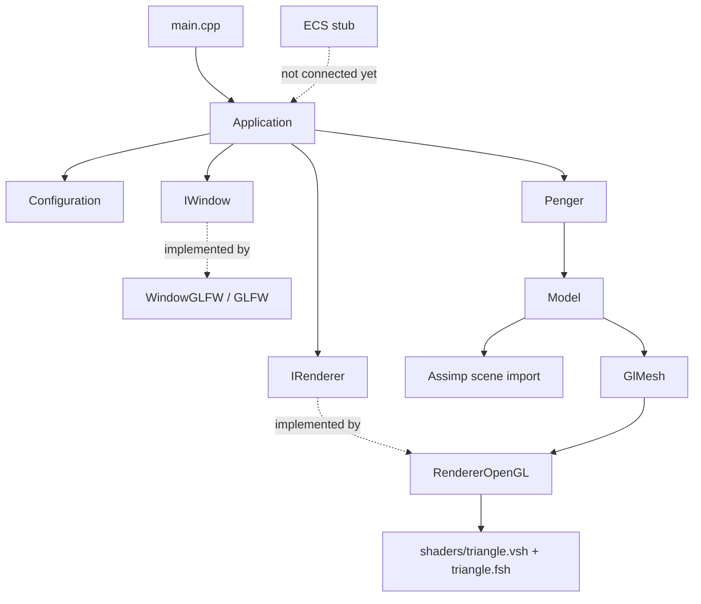

# Code Structure

## Overview

This repository contains **Luna Rendering Engine**, a small C++ rendering prototype. The executable currently creates a GLFW window and an OpenGL renderer, loads an OBJ model through Assimp, and draws it from the application loop. The project also has early window and renderer interfaces, shader files, model assets, and an ECS stub. Vulkan, Metal, text rendering, and ECS-driven gameplay are not implemented yet.

## Repository map

```text
.
├── CMakeLists.txt              # Application and dependency build configuration
├── docs/
│   └── CODE_STRUCTURE.md       # This guide
├── external/
│   ├── glfw/                   # GLFW source submodule
│   └── assimp/                 # Assimp source submodule
├── include/
│   ├── glad/                   # OpenGL function loader
│   ├── glm/                    # Math library
│   ├── KHR/                    # Khronos headers used by GLAD
│   ├── CLI11.hpp
│   ├── stb_image.h             # Image loading implementation is compiled in RendererOpenGL.cpp
│   └── tiny_obj_loader.h
├── penger-obj-main/            # Penger OBJ/MTL/texture assets and variants
├── shaders/                    # GLSL shader pairs
└── src/
    ├── main.cpp                # Program entry point
    └── engine/
        ├── Application.hpp/.cpp
        ├── ecs/ECS.hpp/.cpp
        ├── graphics/
        │   ├── IRenderer.hpp
        │   ├── Model.hpp/.cpp
        │   └── opengl/RendererOpenGL.hpp/.cpp
        ├── objects/Penger.hpp/.cpp
        └── platform/
            ├── IWindow.hpp
            └── glfw/WindowGLFW.hpp/.cpp
```

## How the current program is connected



The dashed ECS connection is a future direction, not an existing runtime path. Although `IWindow` and `IRenderer` provide interface seams, the graphics data path still depends directly on OpenGL types such as `GlMesh`.

## Startup and frame loop

### Entry point

[`../src/app/main.cpp`](../src/app/main.cpp) creates a 1280×720 application and starts it:

```cpp
std::string title = "video";
auto* app = new Application(1280, 720, title);
app->Run();
```

The entry point uses a heap allocation and does not delete `app`. The engine setup and loop live in [`Application.cpp`](../src/engine/Application.cpp).

### Application setup

`Application` owns a `Configuration`, an `IWindow`, and an `IRenderer` with `std::unique_ptr`. The current constructor selects OpenGL directly, creates the GLFW window, then creates and initializes the OpenGL renderer:

```cpp
config->rendering_api = Backend::OpenGL;
window = std::make_unique<WindowGLFW>(*config, title, this);
renderer = std::make_unique<RendererOpenGL>();
renderer->init(window.get(), width, height);
```

`Configuration::Load()` is a stub and its return value is ignored. The backend is not selected from a config file or command-line option. Vulkan and Metal cases throw because those renderers are not implemented.

### Per-frame work

`Application::Run()` loads the triangle shader, constructs `Penger`, shows the window, and runs until GLFW reports close:

```cpp
GLShader shader("shaders/triangle.vsh", "shaders/triangle.fsh");
Penger penger;
window->Show();

while (!window->ShouldClose()) {
    renderer->clear({0.2f, 0.3f, 0.3f, 1.0f});
    penger.Draw(shader);
    window->SwapBuffers();
    window->PollEvents();
}
```

The loop clears and draws directly. `beginFrame()` and `endFrame()` exist on `IRenderer`, but are not called here and are empty in the current OpenGL implementation.

## Platform window

[`IWindow.hpp`](../include/engine/platform/IWindow.hpp) defines the window-facing API and the `Backend` enum (`None`, `OpenGL`, `Vulkan`, `Metal`). [`WindowGLFW`](../src/engine/platform/WindowGLFW.cpp) implements the API using GLFW. It creates the window/context, loads OpenGL functions with GLAD, installs callbacks, shows the window, polls events, swaps buffers, and checks the close flag.

For OpenGL, GLFW creates the context and the implementation loads GL functions after making it current:

```cpp
glfwMakeContextCurrent(handle);
if (backend == Backend::OpenGL && !gladLoadGL(glfwGetProcAddress)) {
    throw std::exception();
}
```

The keyboard, cursor, and mouse callbacks are currently empty. The framebuffer resize callback calls `glViewport` directly, so even the platform implementation has an OpenGL-specific behavior. `CreateSurface()` is a placeholder for Vulkan; the Vulkan initialization path throws before it could be used.

## Rendering and graphics data

### Interfaces and OpenGL classes

[`IRenderer.hpp`](../include/engine/graphics/IRenderer.hpp) declares `IShader`, `IMesh`, `IRenderer`, plus shared `Vertex` and `Texture` data structures. `RendererOpenGL` implements renderer initialization and framebuffer clearing. `GLShader` loads, compiles, and links a vertex/fragment shader program. `GlMesh` owns OpenGL vertex, index, and array buffer handles, uploads geometry, and issues indexed triangle draws.

The mesh setup binds position, normal, and texture-coordinate attributes:

```cpp
glEnableVertexAttribArray(0); // position
glEnableVertexAttribArray(1); // normal
glEnableVertexAttribArray(2); // texture coordinates
```

The shader uniform setters are commented out, shader compile/link checks are disabled, and `RendererOpenGL::drawMesh()` currently only casts the shader to `GLShader`; it does not draw the passed mesh. `GlMesh::Draw()` contains the actual OpenGL indexed draw path. These two paths are therefore not yet fully connected.

### Model import

[`Model.cpp`](../src/engine/graphics/Model.cpp) asks Assimp to triangulate the model, generate smooth normals, flip UVs, and calculate tangent space. It traverses the imported scene nodes, converts each Assimp mesh into the engine’s `Vertex`/index/texture arrays, and constructs a `GlMesh`:

```cpp
const aiScene* scene = importer.ReadFile(
    path,
    aiProcess_Triangulate | aiProcess_GenSmoothNormals |
    aiProcess_FlipUVs | aiProcess_CalcTangentSpace);
```

Material texture references are cached per `Model`. `TextureFromFile()` in `RendererOpenGL.cpp` uses `stb_image` to load image data and uploads it as an OpenGL texture. The current model pipeline is OpenGL-specific despite the general `Model` name.

### Penger object and assets

[`Penger`](../src/engine/objects/Penger.cpp) is a thin wrapper around `Model`: it constructs the model from `penger-obj-main/penger/penger.obj` and forwards `Draw()` to it. The asset directory also includes the `cyber`, `real-penger`, and `suitger` variants, each with OBJ/MTL/texture files and some screenshots. Asset paths are relative to the process working directory, so the executable must be launched from a directory where those paths resolve.

## ECS: current stub and a possible next step

[`ECS.hpp`](../include/engine/systems/entity/ECS.hpp) is only a sketch today. `EntityComponent` is empty; `Entity` contains a numeric ID and a vector of those empty components. `System` declares a map-based storage and `AddComponent()`, but neither has a working implementation. `ECS.cpp` is empty apart from a `Luna::Registry` namespace, which does not match the `Luna::ECS` namespace in the header. `Application` and `Penger` do not use this code.

A useful next step is to make the Penger an entity whose data is held in small, independent components, then have a system interpret those components. For example, this is a **design sketch only**; these types and APIs are not implemented in the repository:

```cpp
struct Transform {
    glm::vec3 position;
    glm::vec3 rotation;
    glm::vec3 scale;
};

struct ModelReference {
    Model* model;
};

// Conceptual setup; exact World/Registry API is still to be designed.
Entity penger = world.createEntity();
world.add(penger, Transform{/* position, rotation, scale */});
world.add(penger, ModelReference{&pengerModel});
```

The next architectural move would be for a render system to find entities with both `Transform` and `ModelReference`, then submit their models to the renderer. This separates “what the Penger is” (component data) from “how it is drawn” (system behavior). Before wiring it into the frame loop, define entity lifetime/IDs, component storage, and how render systems access renderer resources; avoid storing OpenGL handles directly in general-purpose ECS components if another backend is planned.

## Shaders

The application currently loads [`triangle.vsh`](../shaders/triangle.vsh) and [`triangle.fsh`](../shaders/triangle.fsh). The vertex shader transforms positions using `model`, `view`, and `projection`; the fragment shader samples `ourTexture`. The current application flow does not set those uniforms, and the shader methods that would set uniforms are placeholders.

```glsl
// triangle.vsh: transform a vertex to clip space
gl_Position = projection * view * model * vec4(aPos, 1.0);
```

[`text.vsh`](../shaders/text.vsh) and [`text.fsh`](../shaders/text.fsh) are a separate text shader pair. There is no C++ text-rendering subsystem that loads or uses them.

## Build configuration and dependencies

The root [`CMakeLists.txt`](../CMakeLists.txt) builds one executable from `src/` and the GLAD C implementation. GLFW and Assimp are source submodules under `external/`; Assimp tests, tools, samples, and install rules are disabled for this embedded build. `BUILD_SHARED_LIBS` controls whether GLFW and Assimp are shared libraries and defaults to `OFF`. Vulkan package discovery is opt-in through `ENGINE_ENABLE_VULKAN`, but enabling the dependency does not implement a Vulkan renderer.

CMake tests whether the selected compiler accepts the C++26 dialect and falls back to C++23 if it does not. The MSVC target also receives `/utf-8` and `/bigobj`. The `include/` directory supplies GLAD, GLM, stb_image, CLI11, and tinyobjloader headers. FreeType, spdlog, and ImGui are not linked by the current build.

## Current boundaries

- Only the GLFW/OpenGL runtime path is created by `Application`.
- `Backend::Vulkan` and `Backend::Metal`, Vulkan surface creation, and the ECS are placeholders.
- `IWindow` is an interface, but its resize callback calls OpenGL directly.
- `IRenderer::drawMesh()` accepts `GlMesh`, which couples the renderer interface to OpenGL.
- The application calls `Penger::Draw()` directly; no scene or ECS update/render system exists.
- Shader validation and uniform updates are disabled or incomplete, and `drawMesh()` is not connected to `GlMesh::Draw()`.
- The text shaders are present without a matching C++ text renderer.

## Suggested reading order

1. [`../src/app/main.cpp`](../src/app/main.cpp) — entry point.
2. [`src/engine/Application.cpp`](../src/engine/Application.cpp) — startup and loop.
3. [`../include/engine/platform/IWindow.hpp`](../include/engine/platform/IWindow.hpp) and [`WindowGLFW.cpp`](../src/engine/platform/WindowGLFW.cpp) — window contract and GLFW implementation.
4. [`../include/engine/graphics/IRenderer.hpp`](../include/engine/graphics/IRenderer.hpp) and [`RendererOpenGL.cpp`](../src/engine/graphics/opengl/RendererOpenGL.cpp) — graphics interfaces and current backend.
5. [`src/engine/graphics/Model.cpp`](../src/engine/graphics/Model.cpp) — Assimp import and mesh conversion.
6. [`src/engine/objects/Penger.cpp`](../src/engine/objects/Penger.cpp) — model wrapper.
7. [`../include/engine/systems/entity/ECS.hpp`](../include/engine/systems/entity/ECS.hpp) — ECS starting point and gaps.
